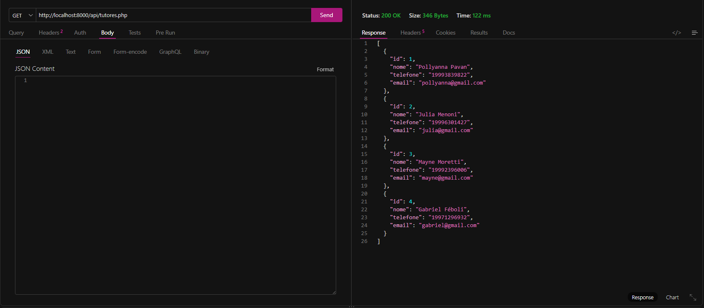
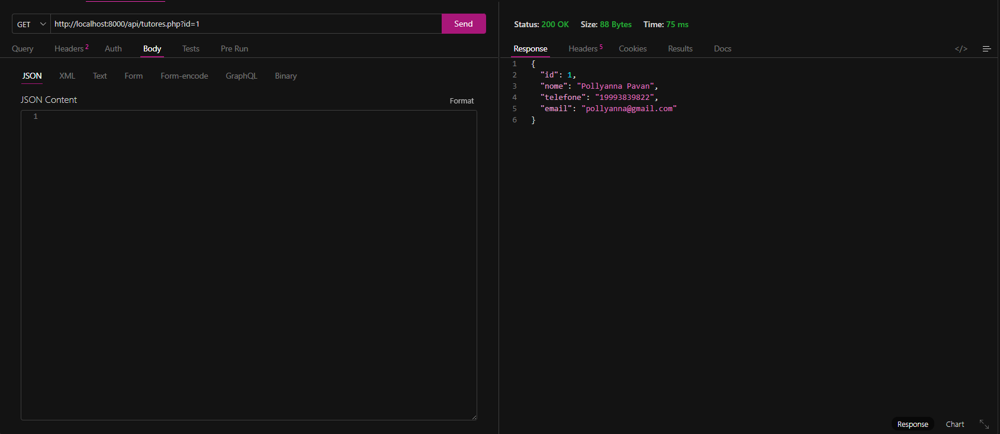
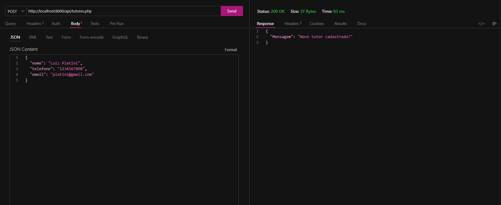
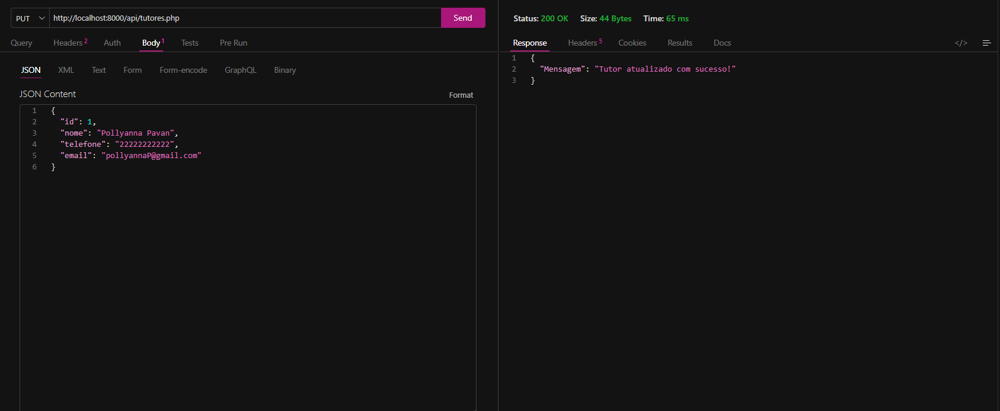
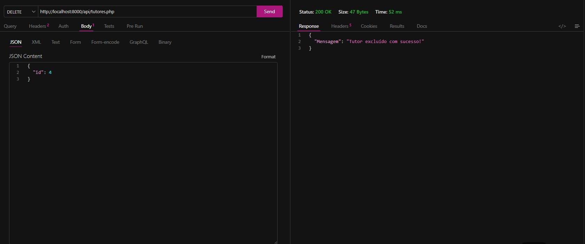

# PetCare — Sistema de Gerenciamento Veterinário

## *Projeto Integrador — Banco de Dados Relacionais e API em PHP*

## 1. Integrantes

- **Integrante 1:** Mayne Zardo Moretti
- **Integrante 2:** Pollyanna Rodrigues Pavan
- **Integrante 3:** Julia Guerra Menoni

> **I1D46B — Técnico em Desenvolvimento de Sistemas — SENAI Americana**

## 2. Descrição da proposta

O PetCare é um sistema de gerenciamento veterinário desenvolvido para facilitar a organização de tutores, animais, veterinários e consultas. O projeto centraliza as informações em um banco de dados, tornando o cadastro, a consulta e o gerenciamento dos registros mais simples.

O sistema é destinado a clínicas veterinárias, veterinários e funcionários responsáveis pelo atendimento e pelo agendamento de consultas.

## 3. Funcionalidades

O projeto possui uma interface web integrada com uma API em PHP e um banco de dados PostgreSQL.

As principais funcionalidades são:

- Cadastro, listagem, consulta, atualização e exclusão de tutores.
- Cadastro e consulta de veterinários.
- Cadastro e consulta de animais e seus respectivos tutores.
- Registro e consulta de consultas veterinárias.
- Organização das informações por meio de consultas SQL.
- Comunicação entre frontend e backend por requisições HTTP.
- Exibição dos dados em tabelas na interface web.

A página inicial contém o cadastro e a listagem de tutores. As demais funcionalidades ficam separadas em páginas próprias.

## 4. Tecnologias utilizadas

- **HTML5:** estrutura das páginas.
- **CSS3:** aparência, cores e organização visual.
- **JavaScript:** interações da página e comunicação com a API.
- **PHP:** desenvolvimento dos endpoints da API.
- **PDO:** conexão do PHP com o PostgreSQL.
- **PostgreSQL:** banco de dados relacional.
- **Thunder Client:** ferramenta utilizada para testar as requisições da API.
- **Visual Studio Code:** editor utilizado no desenvolvimento.

## 5. Banco de dados

O banco de dados utilizado se chama `petcare` e possui quatro tabelas principais.

### Tabela `tutores`

Armazena os dados dos responsáveis pelos animais.

- `id`: chave primária e identificador do tutor.
- `nome`: nome do tutor.
- `telefone`: telefone para contato.
- `email`: e-mail do tutor.

### Tabela `veterinarios`

Armazena os dados dos profissionais.

- `id`: chave primária.
- `nome`: nome do veterinário.
- `crmv`: registro profissional.
- `telefone`: telefone para contato.

### Tabela `animais`

Armazena os dados dos animais cadastrados.

- `id`: chave primária.
- `nome`: nome do animal.
- `especie`: espécie do animal.
- `raca`: raça do animal.
- `data_nascimento`: data de nascimento.
- `tutor_id`: chave estrangeira que referencia `tutores(id)`.

Um tutor pode estar relacionado a vários animais. Cada animal cadastrado possui um tutor associado.

### Tabela `consultas`

Armazena os dados dos atendimentos veterinários.

- `id`: chave primária.
- `animal_id`: chave estrangeira que referencia `animais(id)`.
- `veterinario_id`: chave estrangeira que referencia `veterinarios(id)`.
- `data_consulta`: data da consulta.
- `motivo`: motivo do atendimento.
- `status`: situação da consulta.

Cada consulta está relacionada a um animal e a um veterinário. Um animal ou veterinário pode aparecer em várias consultas.

## 6. Relacionamentos

O banco utiliza chaves primárias e estrangeiras para relacionar os registros:

- `tutores` → `animais`: relacionamento de um para muitos, por meio de `animais.tutor_id`.
- `animais` → `consultas`: relacionamento de um para muitos, por meio de `consultas.animal_id`.
- `veterinarios` → `consultas`: relacionamento de um para muitos, por meio de `consultas.veterinario_id`.

Esses relacionamentos ajudam a manter a integridade dos dados e evitam que animais ou consultas sejam associados a registros inexistentes.

## 7. Estrutura do projeto

```text
PetCare-BCD/
├── api/
│   ├── .gitignore
│   ├── conexao.php
│   ├── tutores.php
│   ├── veterinarios.php
│   ├── animais.php
│   └── consultas.php
│
├── frontEnd/
│   ├── index.html
│   ├── veterinarios.html
│   ├── animais.html
│   ├── consultas.html
│   ├── style.css
│   └── script.js
│
├── banco.sql
├── consultas.sql
└── README.md
```

### Arquivos principais

- `banco.sql`: criação das tabelas e inserção dos dados iniciais.
- `consultas.sql`: exemplos de `INSERT`, `SELECT`, `WHERE`, `ORDER BY`, `UPDATE`, `DELETE` e `JOIN`.
- `api/conexao.php`: configuração da conexão PDO com o PostgreSQL.
- `api/tutores.php`: operações da API para tutores.
- `api/veterinarios.php`: operações da API para veterinários.
- `api/animais.php`: operações da API para animais.
- `api/consultas.php`: operações da API para consultas.
- `frontEnd/index.html`: página inicial e gerenciamento de tutores.
- `frontEnd/veterinarios.html`: página de veterinários.
- `frontEnd/animais.html`: página de animais.
- `frontEnd/consultas.html`: página de consultas.
- `frontEnd/style.css`: estilos compartilhados pelas páginas.
- `frontEnd/script.js`: funções JavaScript e comunicação com a API.
- `README.md`: documentação do projeto.

## 8. Como criar e configurar o banco de dados

### 8.1. Criar o banco

No PostgreSQL, execute:

```sql
CREATE DATABASE petcare;
```

Se o banco já existir, não é necessário criá-lo novamente.

### 8.2. Criar as tabelas e inserir os dados

1. Conecte-se ao banco `petcare`.
2. Abra o arquivo `banco.sql`.
3. Execute os comandos de criação das tabelas e de inserção dos dados iniciais.

Se as tabelas e os dados já estiverem criados, evite executar novamente os comandos de inserção para não duplicar registros.

### 8.3. Consultar os dados

O arquivo `consultas.sql` contém exemplos de consultas para visualizar e organizar os dados, além de comandos de atualização e exclusão.

Antes de executar comandos `UPDATE` ou `DELETE`, confira o registro identificado pelo `WHERE`, pois essas operações alteram ou excluem dados.

## 9. Configuração da conexão PHP

No arquivo `api/conexao.php`, configure os dados de acesso ao PostgreSQL:

```php
<?php
declare(strict_types=1);

$host = "SEU_IP";
$usuario = "SEU_USUARIO";
$senha = "SUA_SENHA";
$banco = "petcare";

$pdo = new PDO(
    "pgsql:host=$host;port=5432;dbname=$banco",
    $usuario,
    $senha
);
?>
```

Substitua os valores pelos dados configurados no seu PostgreSQL. Se estiver usando o banco local, o host normalmente pode ser `127.0.0.1`.

Não compartilhe a senha real do banco em repositórios públicos.

## 10. Como executar a API

Abra o terminal na pasta principal do projeto e inicie o servidor PHP:

```bash
php -S localhost:8000
```

Com o servidor iniciado, os endpoints ficam disponíveis pelo endereço:

```text
http://localhost:8000/api/
```

Exemplo do endpoint de tutores:

```text
http://localhost:8000/api/tutores.php
```

Esse endereço pressupõe que a pasta `api` esteja dentro da pasta principal e que a conexão com o banco esteja funcionando.

Se o comando for executado de dentro da pasta `api`, o endereço do endpoint será:

```text
http://localhost:8000/tutores.php
```

## 11. Endpoints da API

A API utiliza métodos HTTP para realizar as operações CRUD. CRUD significa criar, consultar, atualizar e excluir registros.

### 11.1. Métodos CRUD

| Método HTTP | Operação | Descrição |
|---|---|---|
| GET | Read | Lista ou consulta registros |
| POST | Create | Cadastra um registro |
| PUT | Update | Atualiza um registro |
| DELETE | Delete | Exclui um registro |

### 11.2. Endpoints de tutores

| Método | Endpoint | Descrição |
|---|---|---|
| GET | `/api/tutores.php` | Lista todos os tutores |
| GET | `/api/tutores.php?id=1` | Consulta tutor pelo ID |
| POST | `/api/tutores.php` | Cadastra tutor |
| PUT | `/api/tutores.php?id=1` | Atualiza tutor |
| DELETE | `/api/tutores.php?id=1` | Exclui tutor |

Os endpoints devem ser conferidos de acordo com a implementação atual dos arquivos PHP.

### 11.3. GET — Listar tutores

Requisição:

```http
http://localhost:8000/api/tutores.php
```

Exemplo de resposta JSON:

```json
[
  {
    "id": 1,
    "nome": "Pollyanna Pavan",
    "telefone": "19993839840",
    "email": "pollyanna@gmail.com"
  }
]
```

A resposta é apenas um exemplo. Os dados retornados dependem dos registros existentes no banco.

**Imagem — Comprovação da resposta pelo método GET**



### 11.4. GET — Consultar tutor por ID

Requisição:

```http
http://localhost:8000/api/tutores.php?id=1
```

Exemplo de resposta JSON:

```json
{
  "id": 1,
  "nome": "Pollyanna Pavan",
  "telefone": "19993839840",
  "email": "pollyanna@gmail.com"
}
```

Se o tutor não existir, a API deve informar que o registro não foi encontrado, de preferência utilizando o status HTTP `404`.

**Imagem — Comprovação da consulta por ID**



### 11.5. POST — Cadastrar tutor

Requisição:

```http
http://localhost:8000/api/tutores.php
```

Corpo JSON enviado:

```json
{
  "nome": "Luiz Platini",
  "telefone": "1234567890",
  "email": "platini@gmail.com"
}
```

Exemplo de resposta:

```json
{
  "mensagem": "Novo tutor cadastrado!"
}
```

A API deve verificar se os campos necessários foram enviados e informar quando os dados forem inválidos.

**Imagem — Comprovação do cadastro pelo método POST**



### 11.6. PUT — Atualizar tutor

Requisição:

```http
http://localhost:8000/api/tutores.php?id=1
```

Corpo JSON enviado:

```json
{
  "nome": "Pollyanna Pavan",
  "telefone": "22222222222",
  "email": "pollyannaP@gmail.com"
}
```

Exemplo de resposta:

```json
{
  "mensagem": "Tutor atualizado com sucesso!"
}
```

Se o ID não corresponder a um tutor existente, a API deve informar que o registro não foi encontrado.

**Imagem — Comprovação da atualização pelo método PUT**



### 11.7. DELETE — Excluir tutor

Requisição:

```http
http://localhost:8000/api/tutores.php
```

Corpo JSON enviado:

```json
{
  "id": 4
}
```

Exemplo de resposta:

```json
{
  "mensagem": "Tutor excluído com sucesso!"
}
```

Se o tutor não existir, a API deverá retornar uma mensagem informando que o registro não foi encontrado, preferencialmente com status HTTP `404`.

A exclusão também deve respeitar as chaves estrangeiras do banco. Caso o tutor possua animais associados, o banco poderá impedir a exclusão. A API deve tratar essa situação sem expor detalhes técnicos internos.

**Imagem — Comprovação da exclusão pelo método DELETE**



## 12. Validações e segurança

A API deve utilizar os seguintes cuidados:

- Consultas preparadas com parâmetros para evitar SQL Injection.
- Verificação dos campos obrigatórios.
- Validação do identificador informado.
- Respostas no formato JSON.
- Códigos HTTP apropriados para sucesso e erro.
- Tratamento de registros inexistentes.
- Tratamento de erros de conexão e restrições do banco.
- Não mostrar senhas ou informações confidenciais nas mensagens de erro.

## 13. Como testar a API

Os testes podem ser realizados pelo Thunder Client no VS Code.

1. Inicie o servidor PHP da API.
2. Confira se a conexão com o PostgreSQL está funcionando.
3. Envie uma requisição `GET` para listar os tutores.
4. Envie uma requisição `POST` com os dados em JSON.
5. Consulte o tutor cadastrado pelo ID.
6. Envie uma requisição `PUT` para atualizar os dados.
7. Teste o `DELETE` com um registro apropriado.
8. Teste IDs inexistentes e campos obrigatórios ausentes.
9. Confira o status HTTP e o conteúdo JSON de cada resposta.

As operações de atualização e exclusão devem ser testadas com cuidado para evitar a perda de dados necessários ao projeto.

## 14. Como acessar o frontend

O frontend está na pasta `frontEnd` e possui páginas separadas para organizar melhor as funcionalidades.

### Páginas do sistema

- **Início (`index.html`):** página inicial com cadastro e listagem de tutores.
- **Veterinários (`veterinarios.html`):** página para acessar os dados dos veterinários.
- **Animais (`animais.html`):** página para cadastrar e consultar animais e seus tutores.
- **Consultas (`consultas.html`):** página para organizar os dados das consultas veterinárias.

Todas as páginas utilizam o mesmo arquivo CSS para manter o visual padronizado e o mesmo JavaScript para realizar as operações e se comunicar com a API.

### Iniciar o frontend

Abra outro terminal, entre na pasta `frontEnd` e execute:

```bash
php -S localhost:8080
```

Depois, acesse pelo navegador:

```text
http://localhost:8080
```

### Integração frontend e backend

Para o site funcionar, é necessário manter os dois servidores em execução:

- **Frontend:** `http://localhost:8080`
- **API PHP:** `http://localhost:8000`

O JavaScript utiliza `fetch()` para enviar requisições HTTP para os arquivos PHP. A API recebe os dados, acessa o PostgreSQL e retorna as respostas em JSON.

Como o frontend e a API utilizam portas diferentes, pode ser necessário configurar o CORS nos arquivos PHP. A API também deve permitir os métodos HTTP utilizados pelo projeto, como GET, POST, PUT e DELETE.

## 15. Como os métodos CRUD aparecem no site

As operações CRUD são utilizadas pelas ações da interface:

- **GET:** quando a página carrega, o JavaScript busca os registros e mostra as informações nas tabelas.
- **POST:** quando o usuário preenche um formulário e realiza um novo cadastro.
- **PUT:** quando o usuário seleciona um registro para editar e salva as alterações.
- **DELETE:** quando o usuário seleciona a opção de excluir um registro.

O frontend envia a requisição para a API PHP, que realiza a operação no banco PostgreSQL e retorna uma resposta.

## 16. Considerações finais

O PetCare é um projeto acadêmico que aplica conhecimentos de banco de dados relacionais, SQL, desenvolvimento web e integração entre frontend e backend.

Durante o desenvolvimento, são utilizados relacionamentos entre tabelas, operações CRUD, API em PHP, conexão com PostgreSQL e uma interface web para facilitar o gerenciamento das informações de uma clínica veterinária.